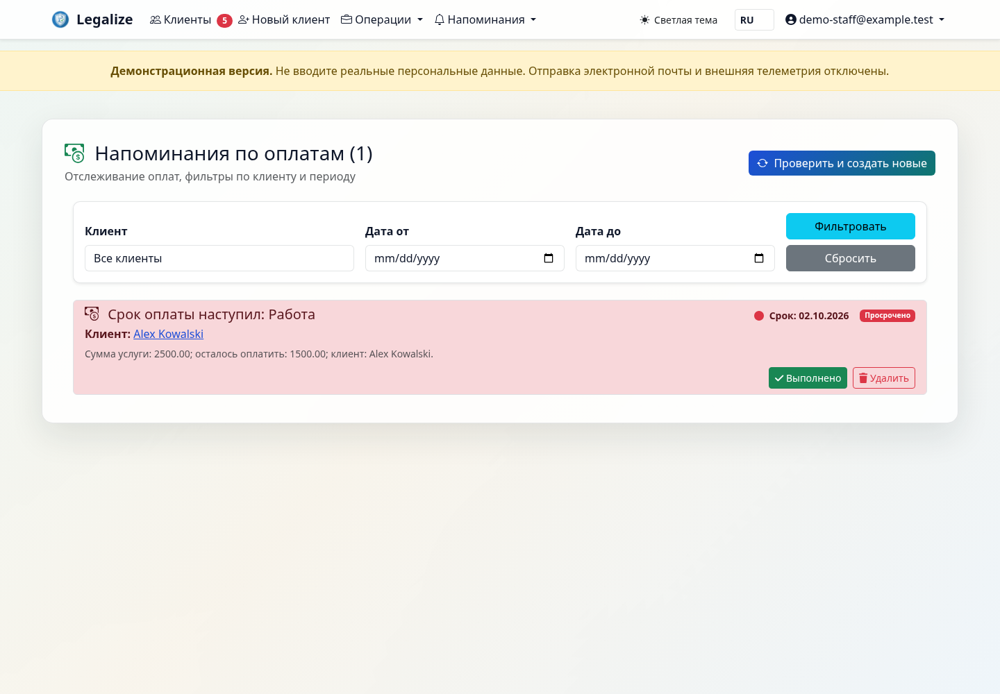
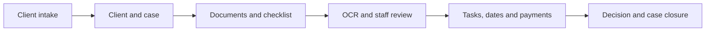
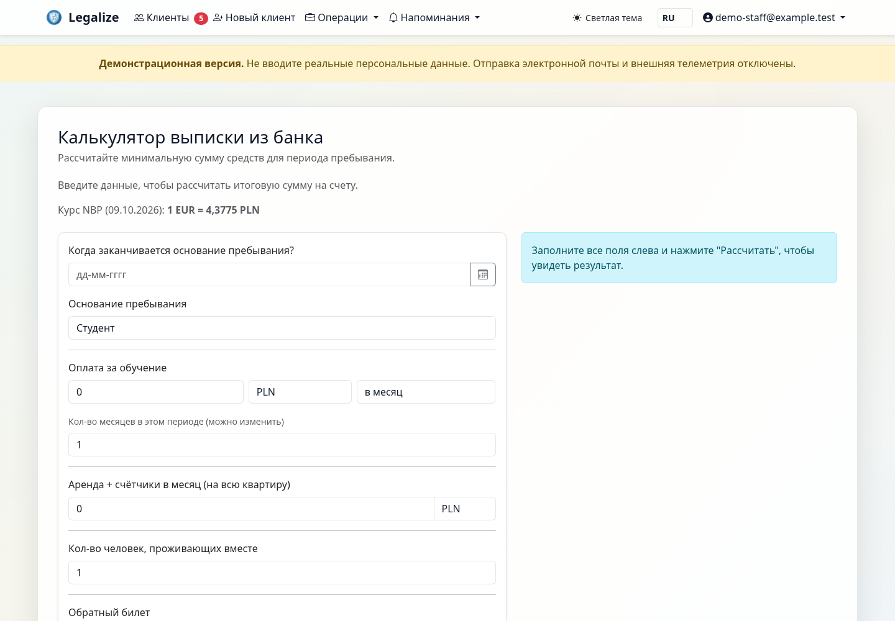
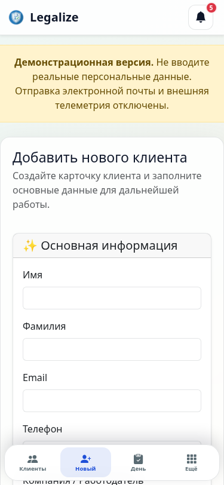
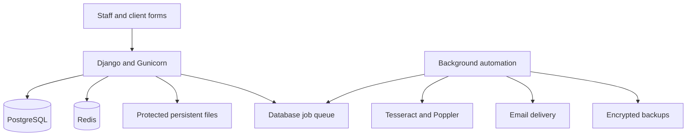

# Legalize

### A CRM for immigration casework in Poland

Clients, residence cases, documents, deadlines and payments in one workspace.
Legalize helps a caseworker see what is missing, what needs review and what to do next.

**Django · PostgreSQL · Redis · Docker · Tesseract OCR**

**Interface: Polski / English / Русский · Stage: preproduction validation**

[Русская версия](README.ru.md) · [Verification record](VERIFICATION.md) · [10-minute demo](DEMO_SCRIPT.md)

*Screenshots show the implemented application with fictional demonstration data.*

## What is implemented

| Area | What a user can do |
|---|---|
| Clients and cases | Keep client identity separate from case progress; manage multiple cases, family links, stages and activity history. |
| Documents | Upload, preview, verify and version files; track completeness and expiration against case requirements. |
| OCR review | Extract information from supported documents, inspect the result and confirm changes before using them in a case. |
| Workday and deadlines | Follow tasks, fingerprint appointments, missing documents, expiring permits and reminders. |
| Payments | Record charges and payments, see outstanding balances and follow up on overdue amounts. |
| Client intake | Collect information through client forms and review it in the staff workspace. |
| Communication | Queue email campaigns and reminders, record delivery status and limit duplicate notifications. |
| Forms and export | Prepare MOS/PESEL data, print case summaries and export case files. The MOS browser extension is a filling-assistant prototype. |
| Staff access | Use roles, object permissions, email MFA, protected file delivery and staff activity logs. |
| Operations | Use encrypted fields, persistent file storage, background jobs and encrypted database backups. |

## A typical workflow

Case stages are **new client → application submitted → fingerprints → waiting for
decision → decision received → closed**. Document work remains available during
every active stage.

## Inside the product

### Financial calculations

Service estimates, financial information and an explicit exchange-rate date or
fallback warning in the reviewed version.

### A narrow-screen client form

## Engineering decisions

- **Cases as a separate domain:** a client can have several processes without mixing their stages and documents.
- **Reviewable OCR:** background jobs track status and retries; staff confirm extracted summons data.
- **Protected personal data:** Fernet field encryption, keyed search indexes, role checks and authenticated downloads.
- **Operational continuity:** shared Redis state, readiness checks, persistent media and backup/restore tooling.
- **Clear deployment scope:** one organization per installation; shared multi-tenant SaaS is a separate development scope.

## What has been verified

| Recorded check | Result | Date |
|---|---|---|
| Full Linux/PostgreSQL run after audit fixes | 1,927 passed; 2 environment-dependent skips; 85.00% Python coverage | 8 Oct 2026 |
| Desktop and mobile route review | 46 desktop + 12 mobile routes | 8–9 Oct 2026 |
| Additional Linux/PostgreSQL regressions | 60 passed; 11 subtests | 14 Oct 2026 |
| Isolated preproduction baseline | HTTPS/readiness, deploy checks, migrations, dependencies and ClamAV EICAR detection passed | 14 Oct 2026 |
| Encrypted backup restored from local S3-compatible storage | Client/case data and five file hashes matched | 14 Oct 2026 |

These are dated results from the reviewed working version, not a live CI badge
or a claim that every checkout or deployment has passed. See the
[verification record](VERIFICATION.md) for the scope and limitations.

## Product status and commercial scope

The implemented product is being prepared for a controlled pilot. OCR requires
human review; the MOS assistant does not guarantee official submission. Load
capacity, legal accuracy across all case types and an external security assessment
are not claimed. Production acceptance is required for each installation.

The intended offering is a dedicated installation with an agreed source-code or
usage license, deployment and support scope. Public portfolio material does not
grant a license to the application source. Third-party components keep their own
licenses and notices.

**Project owner:** [Imper4ik on GitHub](https://github.com/Imper4ik).

Demonstrations use a separate instance with fictional records and captured test
email. Live client accounts are not a public demo.

[Download the product portfolio (PDF, Russian)](Legalize-product-portfolio.pdf)
