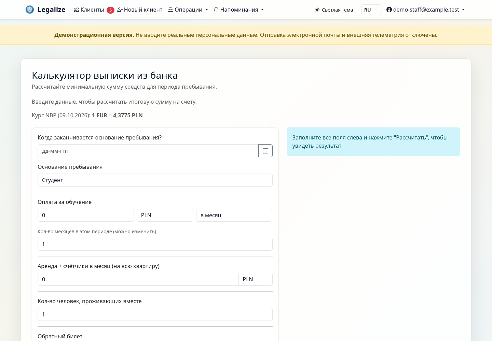
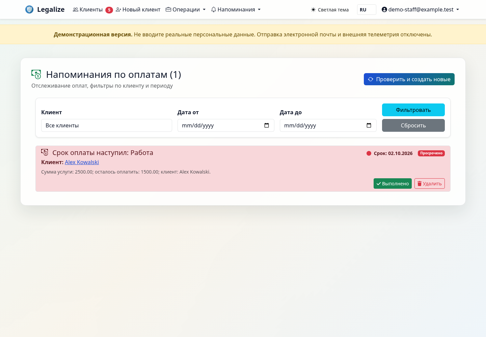
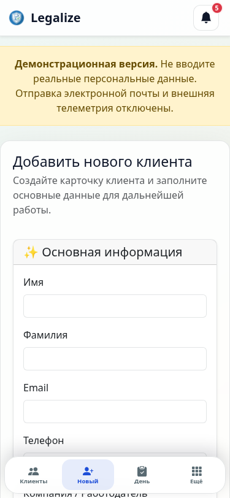

# Legalize

[English version](README.md) · [Подтверждённые проверки](VERIFICATION.md)

**CRM для сопровождения легализации иностранцев в Польше.**

Клиенты, дела, документы, сроки и оплаты в одном рабочем пространстве.
Продукт предназначен для команд, которые помогают клиентам готовить документы
и отслеживать движение дел о пребывании.

## Задача продукта

В одном деле встречаются анкеты, сканы, письма, несколько сроков и платежей.
Legalize связывает их с клиентом и конкретным делом, показывает недостающие
документы и сохраняет историю работы. Ценность продукта - прозрачность процесса
и единое место работы команды. Количественная экономия времени пока не измерялась.

## Что можно показать

- Клиенты и несколько дел на человека, семейные связи, этапы и история изменений.
- Проверка комплектности документов, сроки действия, OCR и подтверждение результатов.
- Клиентская анкета, подготовка сведений MOS/PESEL, печатные формы и экспорт.
- Оплаты, задачи, напоминания и журнал писем.
- Роли сотрудников, обязательный email MFA, ограничения доступа к документам.
- Русский, польский и английский интерфейс; мобильная анкета.

## Реальные экраны на вымышленных данных

Изображения получены при локальной проверке интерфейса. Они не содержат рабочей
базы, документов клиентов или секретов. Это скриншоты реализованного продукта,
а не дизайн будущих функций.

### Финансовый расчёт

### Контроль оплат

### Мобильный интерфейс

## Инженерная основа

Python / Django, PostgreSQL, Redis, Gunicorn, Docker; Tesseract и Poppler для
обработки документов. Чувствительные поля шифруются Fernet, файлы выдаются через
проверку прав. Предусмотрены резервирование и команды проверки восстановления.

В полном Linux/PostgreSQL прогоне 8 октября 2026 года прошли 1 927 тестов,
покрытие Python составило 85%. Дополнительно проверены 46 desktop-маршрутов и
12 mobile-маршрутов. Эти результаты относятся к проверенным сценариям и не
являются гарантией отсутствия всех ошибок или сертификацией безопасности.

## Границы текущей версии

- Один экземпляр для одной организации. Общая многопользовательская SaaS-платформа
  с изоляцией нескольких организаций и биллингом не заявляется.
- OCR помогает извлекать сведения; результат проверяет сотрудник.
- MOS-расширение - прототип помощника заполнения, без обещания автоматической
  официальной подачи или гарантии совместимости со всеми формами портала.
- Продукт находится на этапе подготовки к пилоту. Коммерческие внедрения,
  число платящих пользователей и подтверждённая выручка не заявляются.

## Формат демонстрации

10 минут: клиент и дело → документы и OCR → сроки и оплаты → клиентская анкета →
экспорт и права доступа. Демонстрация проводится на отдельном стенде с тестовой
почтой. Рабочий Railway не используется как публичное демо.

Доступ к исходникам, состав лицензии, внедрение, поддержка и стоимость обсуждаются
отдельно. Показ портфолио сам по себе не предоставляет права использования исходного кода.
